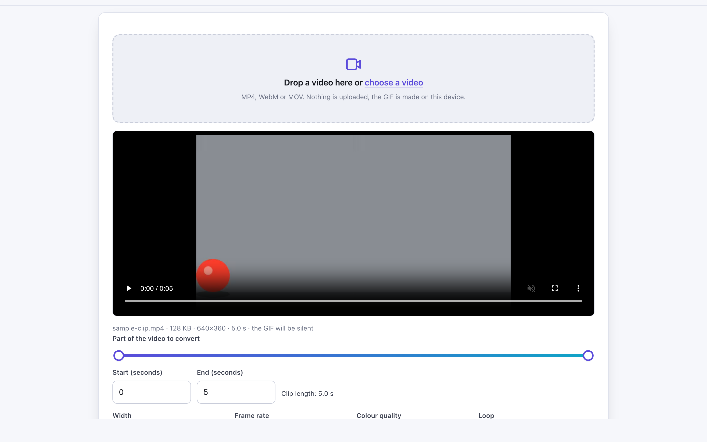
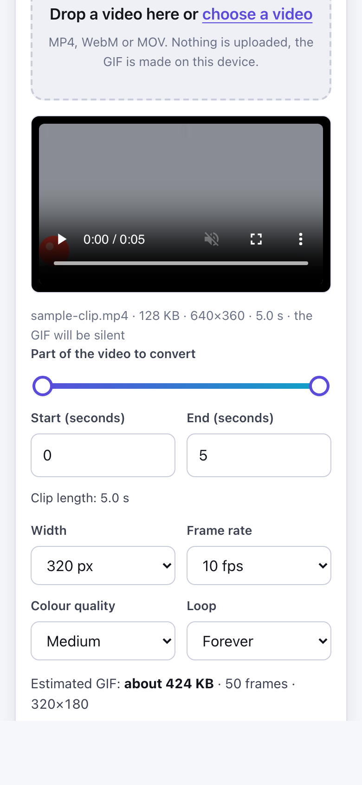

# Video to GIF Converter

> Turn a video clip into a looping GIF in your browser, with size and speed controls and no upload.

**🌐 Use it now: [turhe123.github.io/video-to-gif-local](https://turhe123.github.io/video-to-gif-local/)** · free · open source · runs in your browser · works offline


## Why

Making a GIF from a video is one of the most common conversion jobs. This is a free, open-source alternative to EZGIF Video to GIF (which uploads your video to a server, has a 100 MB upload limit and shows ads on every page). Here your files never leave your device, there is no account, no ads and no limits, it works offline, and it can be installed as an app.

## Screenshots

<p align="center"></p>

<p align="center"><em>Video to GIF Converter in the browser, light theme</em></p>

<p align="center"></p>

<p align="center"><em>Video to GIF Converter on a phone</em></p>

## Features

- Load one video from a file picker or by drag and drop. The video is decoded by your browser, so anything it can play works.
- Video preview with play controls. Space plays or pauses it, and the preview loops inside the part you picked.
- Choose the start and end of the clip with two range sliders or numeric inputs (in seconds).
- Default cap of 20 seconds per GIF. A longer part shows a warning and needs an explicit "Make it anyway".
- Output width: 240, 320, 480 (default), 640 px, or original size up to 800 px. Frames are never upscaled, and large (for example 4K) videos are downscaled while drawing.
- Frame rate: 5, 8, 10 (default), 12 or 15 fps.
- Colour quality: low, medium (default) or high. Higher quality is slower.
- Loop: forever (default) or play once.
- Estimated file size, frame count and dimensions before you start, updated as you change options.
- Refuses jobs above roughly 300 frames at 800 px wide, with a clear message, to avoid running out of memory.
- Exact frames: the page seeks the video frame by frame and draws each one to a canvas. Encoding runs in Web Workers (gif.js), so the page stays responsive.
- Progress bar with frames captured and encoded, and a Cancel button.
- Result shows the animated GIF, frame count, dimensions, real file size and length, and a download button named after your video (`name.gif`).
- Clear errors for files that are not videos, audio-only files, and codecs the browser cannot decode (it suggests an MP4 with H.264).
- Keyboard use: Space plays or pauses the preview, Enter makes the GIF.
- Light and dark themes, layout that works at 390 px wide, installable and usable offline.

**Input:** MP4, M4V, WebM, MOV, MKV, OGV and similar, as far as your browser can decode them (MP4 with H.264 is the safest choice).
**Output:** one animated GIF, silent (GIF has no audio). No text overlays or effects.
**Limits:** 20 seconds by default, output width up to 800 px, about 300 frames at 800 px. GIFs are large; a WebM or MP4 of the same clip is much smaller.

## How to use

1. Drop a video onto the page or choose one from your device.
2. Pick the part to convert with the start and end sliders, and play the preview to check it.
3. Choose width, frame rate, quality and loop, and check the estimated size.
4. Press **Make GIF** (or Enter) and wait for the progress bar to finish.
5. Check the result and press **Download** to save the GIF.

## Privacy

- Nothing is uploaded. Your video is read, decoded and encoded on your device, and the page makes no requests with your files.
- No cookies are used.
- Page views are counted anonymously with [GoatCounter](https://www.goatcounter.com/), which is cookieless and open source.
- The page works offline through a service worker after the first visit.

## Run it locally

```sh
git clone https://github.com/turhe123/video-to-gif-local
cd video-to-gif-local
python3 -m http.server 4173
```

Then open http://127.0.0.1:4173/. There is no build step.

## Tests

```sh
npm i -D @playwright/test && npx playwright install chromium
npx playwright test
```

## Third-party code

- [gif.js](https://github.com/jnordberg/gif.js) 0.2.0, MIT license (in `vendor/gif.js/`, with its LICENSE).

## Built with AI

Video to GIF Converter was written by [Claude Code](https://claude.com/claude-code) inside an automated pipeline, from a plain-English spec. No code or assets from any commercial product were used; it is a clean-room implementation of a feature set, not a copy.

What that means in practice:

- The full source is in this repo under the MIT license. Read it before you trust it with your files.
- Everything runs in your browser. It makes no network requests except an anonymous, cookieless page-view count (GoatCounter); your files never leave the device.
- The page is tested headless in Chromium (Playwright) before every release, but it has had less human review than hand-written software. Bug reports and pull requests are welcome.

## Support ❤️

If this saved you a trip to an upload site, you can support the project on [Ko-fi](https://ko-fi.com/leodavidai).

## More free web tools

See [turhe123.github.io/web-tools](https://turhe123.github.io/web-tools/).

Also: [free, open-source Mac apps](https://turhe123.github.io/mac-apps/) built the same way, native Swift, no accounts, no telemetry.

## License

MIT © Or Davidai Bachar
